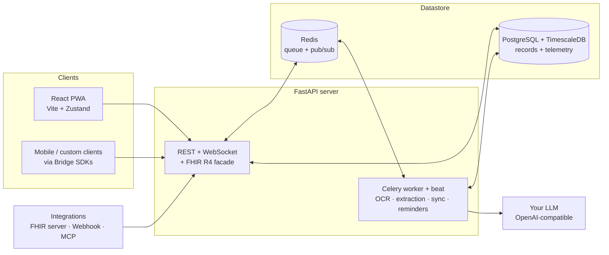

# Health Assistant — Technical Architecture

Health Assistant is a self-hosted, open-source platform for centralizing health and medical data. This document covers the technical architecture: the FastAPI backend, the PostgreSQL + TimescaleDB data model, the HL7 FHIR R4 storage layer with the biomarker engine, the AI/OCR processing pipeline, and the React frontend. The technology-stack table lives in the [README](../README.md#tech-stack).

## System diagram



The frontend talks to **domain endpoints** optimized for the UI; external systems (a hospital's FHIR server, a webhook sender) talk to the **FHIR R4 facade**. Both surfaces sit on the same FHIR-enhanced relational tables — there is no dual-write.

## Repository layout

```
core/
├── backend/       # FastAPI app (app/), alembic migrations, tests/, scripts/
├── integrations/  # bridge client SDK satellites (python/ts/kotlin) — the extension subsystem itself lives in backend/app/extensions/
├── frontend/      # React 18 + Vite + TS + Tailwind + Zustand
├── docs/          # this documentation (docs-tree.json = website nav)
├── docker/        # compose flavors + init scripts
└── scripts/       # run-dev.sh, install.sh, backup.sh, version_manager.py, …
```

## Database Schema

### Core Models (`app/models/`)

- **tenants**: Multi-tenant isolation (id, name, settings)
- **users**: Identity & Auth (id, tenant_id, email, role, settings)
- **fhir_organizations**: Hierarchical grouping (id, tenant_id, name, org_type, part_of_id, created_at, updated_at, deleted_at)
- **fhir_patients**: Clinical profiles (id, tenant_id, user_id, name, gender, birth_date, mrn)
- **clinical_event_types**: Blueprint for specific journeys. Contains `metadata_schema` for dynamic field rendering, `schedule_kind` for calendar rendering, and a NOT NULL `category_concept_id` FK → `concepts.id` (event_category). See [CLINICAL_EVENTS.md](CLINICAL_EVENTS.md) for the seed JSON schema and field reference.
- **clinical_events**: Longitudinal health journeys (patient_id, type_id, status, `event_metadata`). Episodes live in the child table `clinical_event_occurrences` (the former JSONB `occurrences` column is gone — one source of truth). See [CLINICAL_EVENTS.md](CLINICAL_EVENTS.md).
- **event_examination_links**: Many-to-many relationship between events and examinations with clinical reasoning.
- **examinations**: Clinical visit containers (id, patient_id, organization_id, examination_date, notes, patient_notes, `category_concept_id` FK → `concepts.id`)
- **doctors**: Care team profiles (id, tenant_id, user_id, name, `specialty_concept_id` FK → `concepts.id`, license_number, contact_info)
- **documents**: File tracking (id, owner_id, filename, file_path, status, progress, extracted_text, entities, `category_concept_id` FK → `concepts.id`)
- **fhir_observations**: Biomarkers/Vitals (id, `patient_id` FK → `fhir_patients.id` ON DELETE CASCADE, `document_id` FK → `documents.id` ON DELETE SET NULL, biomarker_id, raw_value, normalized_value, relative_score, effective_datetime). Stores numeric results in `value_quantity`, free-text in `value_string`, and categorical STATE biomarker values in `value_codeableConcept`. Multi-state panels use `component[]`.
- **units**: Smart units with conversion logic (id, symbol, quantity_type, conversion_multiplier)
- **biomarker_definitions**: Global catalog (id, slug, coding_system, code, name, aliases, preferred_unit_id, `class_concept_id` FK → `concepts.id`, `value_type` discriminator `quantity|state`, `supports_multi_state` for component[] panels). STATE biomarkers carry an `allowed_states` join set with `is_normal` flags. See [STATE_BIOMARKERS.md](STATE_BIOMARKERS.md).
- **biomarker_states**: Universal catalog of categorical biomarker values (Positive/Negative/Detected/...) drawn from HL7 v3-ObservationInterpretation, SNOMED CT, and FHIR DataAbsentReason. Referenced by STATE biomarkers via `biomarker_allowed_states`.
- **laboratories**: Source tracking for lab reports (id, name, location)
- **telemetry_data**: Long-format TimescaleDB hypertable — one row per `(timestamp, device, slug)` with `value` + `unit`, composite PK `(id, timestamp)`, `tenant_id`/`patient_id` NOT NULL. A new metric is a row-only change (`BiomarkerDefinition.is_telemetry`), never DDL. The aggregate ladder (`telemetry_hourly`/`_daily`/`_monthly`, realtime, 7-day chunks, refresh + 2-year retention policies) is created once by `0002_telemetry`.
- **concepts** + **concept_kind_tags** + **concept_edges**: the unified multi-kind taxonomy / knowledge graph that classifies every entity above. One concept carries multiple domain tags (e.g. "Blood Laboratory" is an examination category, a biomarker class, and a document category). See [TAXONOMY.md](TAXONOMY.md).
- **notification_triggers**: Scheduling rules for TIME/RECURRING reminders (medication / exam). `TriggerType.EVENT` and the legacy `biomarker_update` hook were removed (use the rules engine below).
- **notifications**: Immutable notification **event** (1 row per emission). Source/category/severity/type, title/body/payload, nullable `patient_id`/`tenant_id` for system broadcasts, optional `communication_id` + `trigger_id`.
- **notification_recipients**: Inbox state (N rows, 1 per resolved user). `user_id`, `status` (unread/read/dismissed). Indexed `(user_id, status)`.
- **notification_deliveries**: Per-channel delivery log (N rows per recipient). `channel` (IN_APP/PUSH/EMAIL/SMS), `status` (pending/sent/delivered/failed), timestamps, error.
- **notification_rules**: Event-driven biomarker threshold rules — replaces the removed `alerts` table. Evaluated on observation ingestion (`fhir_service.create_observation` → `evaluate_and_fire`).
- **notification_subscriptions**: Web Push (VAPID) credentials per user. Dead-endpoint self-pruning on HTTP 410/404.
- **user_integrations** + **integration_credentials** + **integration_sync_state**: connector framework. `user_integrations.user_config` is **configuration only**; sealed secrets live in `integration_credentials` (one slot per `(instance, kind)` — `oauth2|api_key|signed`, the at-rest cipher wrapper in `sealed_blob`, its key fingerprint in `kid`, `scopes`, access/refresh expiry, `rotated_at`/`revoked_at`), and cursors + sync health live in `integration_sync_state` (`stream` = `observations|documents|appointments|labs|telemetry`, `cursor_key` for provider-scoped sub-cursors, `cursor_kind` = `timestamp|page_token|etag|commit`, `cursor_value`, `last_success_at`/`last_error_at`/`last_error_class`, `consecutive_failures`, `next_retry_at`). Backoff is data: the beat reads `next_retry_at`. Every connector write goes through `services/integrations/integration_ingest.py`.
- **proposals** + **proposal_kinds**: the one HITL proposal store. Every AI-proposed write — chat cards, extension `pull_hitl_proposals` specs, automation jobs — is one row: `source` (`chat|extension|automation`, CHECK-mirrored) + `source_ref` (chat message / integration instance / job) + `ordinal` (card order), `kind_id` FK → the seeded `proposal_kinds` vocabulary, `status` (the seven-state machine `proposed|approved|rejected|applied|failed|expired|superseded`), the versioned card document (`payload` + `payload_schema_version`), the user-approved `final_payload`, a tenant-unique `dedup_key`, the state timestamps and the audit-grade `resolution_trace`. `proposal_kinds` is seeded at boot from `contracts/hitl-proposal-kinds.json` (canonical in the shared family contract set, vendored at `backend/app/extensions/`); a new kind is a contract entry plus a row, never DDL.
- **erasure_requests**: the data-subject erasure ledger. `subject_type` (`user|patient|tenant`, CHECK-mirrored), `subject_id`, `requested_by`, `status` (`queued|running|done|failed|dry_run_done`), `dry_run`, the ordered-walker impact report (`report` + `report_schema_version`) and run timestamps. `done` rows replay against every restore so a backup cannot resurrect an erased subject; `tenant_id` is nullable (`ON DELETE SET NULL`) so a tenant erasure outlives its tenant.
- **retention_policies**: retention as operator-editable data — `scope` (`class|table`) + `scope_value`, `action` (`delete|anonymize`), `days`, `timestamp_column`, `enabled`. Seeded at boot (insert-missing only), read by the daily `apply_retention_policies` job and the checkpoint pruner; no retention window lives in code or env.

### Schema governance

The schema is **model-first**: `backend/app/models/` is the single source of
truth and every migration matches it exactly.

- **One linear chain** in `backend/alembic/versions/`, squashed to
  `0001_baseline` on 2026-10-21. Revision ids are sequential
  (`NNNN_slug`, zero-padded to four digits) — mnemonic ids are retired.
  `0001_baseline` reproduces the models (65 tables, the Timescale hypertable,
  extensions, the expression indexes) and carries no CAGG shape;
  `0002_telemetry` creates the frozen aggregate ladder. DDL revisions
  serialise through a **single migration lane**: a parallel branch rebases and
  renumbers onto the new head before committing.
- **`naming_convention` on `Base.metadata`** renders every constraint and
  index name (`pk_`, `fk_`, `ck_`, `uq_`, `ix_`). Model-side constraint names
  are the short form; `op.drop_constraint` takes the short name, never the
  rendered one.
- **Drift gate** (`tests/test_schema_drift_gate.py`): autogenerate against the
  head-migrated database must produce an empty diff — a model edit without a
  migration (or the reverse) fails the suite. The gate covers model-owned DDL;
  TimescaleDB objects are guarded by `tests/test_telemetry_caggs.py` and the
  raw-SQL search indexes by their existence test in
  `tests/test_schema_parameters.py`.
- **Vocabulary parity** (`tests/test_enum_check_parity.py`): every enum column
  is a `StrEnum` mirrored in the DB (native PG enum labels, or a CHECK where a
  plain column carries the vocabulary). Adding a member without widening the
  mirror fails.
- **JSONB inventory** (`contracts/data-model.jsonb-inventory.txt`): every
  JSON/JSONB column is classified `keep-open` (open payloads: LLM blocks, FHIR
  structures, layout documents) or `typed-out` (a contract that becomes typed
  columns). Gate D5 reads the file.
- **Tenancy**: `TenantMixin` is `NOT NULL` with `ON DELETE CASCADE`;
  `SystemScopeTenantMixin` is the explicit, per-table exception for tables
  that mix system/global rows with tenant rows (seeded taxonomy, catalogs,
  global doctors, system audit events). The hypertable tenancy is the
  documented Timescale delta — a named cleanup job owns it.
- **Tombstones**: hard delete is the default. `deleted_at` exists only on the
  FHIR-R4-exposed resources, where a deleted resource must answer
  `410 Gone`; the set is pinned by `tests/test_schema_parameters.py` and
  `tests/test_data_lifecycle.py` (the latter also pins `SoftDeleteMixin`
  usage itself).
- **Lifecycle + vocabulary inventories**: every table is classified
  `record|operational|transient` in `contracts/data-model.lifecycle.txt`
  (gate D6, complete since plan 6) and mirrored in
  `app/core/data_lifecycle.py`; every JSONB column is classified in
  `contracts/data-model.jsonb-inventory.txt` (gate D5). The classes drive the
  erasure walker (`app/services/data_lifecycle/erasure.py`) and the retention jobs
  (`app/services/data_lifecycle/retention_service.py`).
- **Naming gate (D7, strict)**: `scripts/check-data-model.sh --self` runs this
  repo in **strict** mode — all seven family checks (D1–D7) are green with
  zero findings. D7's vocabulary is the data file
  `scripts/check-data-model.patterns.txt` (`legacy`, `deprecated`, `old_*`,
  `*_v2`, `TODO(ai-refactor)`), scanned over `backend/app` + `frontend/src`;
  it is data, not code, so the gate can never match its own patterns. A
  concept that is current is named without those words — the only sanctioned
  exceptions carry a line-scoped `# gate-allow: *, <reason>` pragma: the audit
  change-record pair (`old_value`/`new_value`, the diff contract, not a legacy
  shape) and the `react-grid-layout/legacy` package subpath. Retired shapes
  have their own floor in `tests/test_retired_shapes.py` (`chat_messages.tasks`
  dropped, no `priority`/stored `is_active` on `ai_task_assignments`, no JSONB
  cursor helpers, one task registry).
- **Repo-specific no-legacy gate**: `scripts/check-no-legacy.sh`
  adds only what D7 cannot see — **N1** every `frontend/src/components/**` file
  is reachable from a real entry point (zero-importer scan,
  `scripts/lib/check_frontend_importers.py`), **N2** exactly one frontend
  lockfile (`pnpm-lock.yaml`), **N3** the documented counts match the code
  (`backend/scripts/check_docs_counts.py`: 20 FHIR resources, 44 router
  modules, 358 handlers), **N4** the schema program's retired shapes stay deleted,
  **N5** the deleted duplicate/dead surfaces never come back
  (`scripts/gate-patterns/deleted-surfaces.txt`), **N6** one service-worker
  registration and a real 404 catch-all, **N7** the retired `supports_*`
  provider-probe vocabulary never returns
  (`scripts/gate-patterns/retired-probes.txt`). Its self-test plants one red
  host per check.
- **Reset**: `./scripts/reset-dev-db.sh` is the only supported dev reset
  (wipes the Postgres volume, recreates the databases and runs
  `alembic upgrade head`). The squash is destructive by design; it landed
  **after** v0.8.0 was published, so a v0.8.0 database records a revision
  that no longer exists. Those databases are refused by the `alembic/env.py`
  preflight with the supported routes (fresh install, or back up and restore
  into a fresh pg16 database) — see
  [INSTALL.md → Upgrading from v0.8.0](./INSTALL.md#upgrading-from-v080).

#### Migration notes (newest first)

**2026-10-24 — `0008_extension_sources` (the imported-extension lane).**
Four tables backing the T2/T3 import lane (extension-charter persistence):
`extension_sources` (registered origins — `kind git|file|registry`, `uri`,
pinned `ref_spec`, the `auth_secret_ref` secret-slot reference, `trust_tier
T2|T3`, `enabled`, fetch-failure columns; nullable `tenant_id` for
system-level sources, CASCADE otherwise), `extension_source_versions`
(**immutable** digest-pinned content — `digest`/`manifest_digest`, the
`envelope` JSONB, `contract_version`, the `pending|approved|rejected|revoked`
state machine and the typed `reason` a rejected registration keeps in the
row; unique per `(source_id, digest)` — a digest change is a NEW row
requiring re-approval), `extension_consents` (one decision per
`(user, version, capability)` — `granted|denied` + `scope_json`; consent
binds to a manifest DIGEST so upgrades re-prompt) and
`extension_isolation_posture` (per `(version, host_profile)` evidence:
`requested_tier` vs `derived_tier` — `contract.derive_tier` is the one
derivation — plus the graded DETECTION `posture` JSONB; `operational`).
Lifecycle classes: sources/versions/consents `record`, posture
`operational` (record 53 / operational 23 / transient 1). Downgrade drops
all four and restores the `0007` shape.

**2026-10-22 — `0007_data_lifecycle` (erasure ledger + retention policies).**
Two tables: `erasure_requests` (the data-subject erasure record and
restore-time ledger; `subject_type user|patient|tenant`, `status
queued|running|done|failed|dry_run_done`, `dry_run`, versioned `report`
JSONB, nullable `tenant_id ON DELETE SET NULL` so a tenant erasure outlives
its tenant) and `retention_policies` (scope `class|table`, action
`delete|anonymize`, `days`, `timestamp_column`, `enabled`; unique per
`(scope, scope_value)`). The erasure walker, the daily retention/orphan jobs
and the checkpoint pruner read these rows; `AI_CHECKPOINT_RETENTION_DAYS` is
retired (the `checkpoints` policy row is the one source). Downgrade drops
both tables; policy rows are re-seeded at boot, never resurrected by DDL.
Lifecycle inventory becomes complete (record 49 / operational 22 /
transient 1) and gate D6 goes green.

**2026-10-22 — `0006_connector_framework` (typed credentials + first-class
sync state).** Two new tables and one typed column:
`integration_credentials` (sealed credential slots — ciphertext + `kid` +
`scopes` + expiry + `rotated_at`/`revoked_at`, unique per
`(user_integration_id, kind)`) and `integration_sync_state` (per
`(integration, stream, cursor_key)` cursor + health row with
`cursor_kind/current_value`, `consecutive_failures` and `next_retry_at`),
plus `integration_sync_logs.error_class` (the typed failure class — charter
codes plus the engine-only `mapping_gap`/`credential`). The old
`user_config["_sync_state"]` JSONB cursor bag is **not backfilled**: the SDK's
`get_sync_cursor`/`set_sync_cursor` JSONB methods are deleted in favor of the
row-backed `get_cursor`/`set_cursor` API, and `alembic downgrade
0005_telemetry_unified` drops both tables and the log column. Lifecycle
inventory gains `integration_credentials :: record` and
`integration_sync_state :: operational`.

**2026-10-21 — `0004_proposals_unified` (one HITL proposal store).**
`integration_proposals` is replaced by `proposals` (create + copy + drop, so
every constraint/index carries the new name) and `chat_messages.tasks` is
dropped **with no replacement column** — ordering lives in
`proposals.ordinal`. The new table adds `source`/`source_ref`/`ordinal`,
`kind_id` → the new seeded `proposal_kinds` lookup, `payload` +
`payload_schema_version`, `final_payload`, a tenant-unique `dedup_key`,
`expires_at`/`resolved_at`/`applied_at`, `resolution_trace` and
`superseded_by`. Status moves to the seven-state machine
(`proposed|approved|rejected|applied|failed|expired|superseded`, varchar +
mirrored CHECK); the migration maps `confirmed→applied`,
`dismissed→rejected`. Chat cards migrate out of the JSONB array (unregistered
`task_type`s are dropped), dedup re-scopes from per-integration to per-tenant,
and `alembic downgrade 0003_ai_task_registry` recreates
`integration_proposals` + `chat_messages.tasks` and rebuilds both from the
unified rows.

**2026-10-21 — `0003_ai_task_registry` (AI task registry, assignment law,
per-AI-call audit).** Three shapes in one revision:
`ai_task_defs` (seeded task vocabulary; `ai_task_assignments.task_type` string →
`task_type_id` FK, legacy engine-task rows deleted), `ai_task_assignments`
gains `fallback_provider_id`/`fallback_model_id` + `revoked_at` and loses
`priority`/`is_active`, and `ai_call_logs` is created. The single-slot law is a
partial unique index with `NULLS NOT DISTINCT` (PG15+; CI/dev/prod are PG16)
over `(tenant_id, user_id, task_type_id) WHERE revoked_at IS NULL`.
`alembic downgrade 0002_telemetry` restores the previous shape (the two dropped
engine-task assignments are deliberately not resurrected). Requires a DB
`alembic upgrade head`; existing dev DBs upgrade cleanly (legacy task rows are
backfilled by code, unknown ones deleted).

**2026-10-21 — `0001_baseline` + `0002_telemetry` (baseline squash, frozen
telemetry ladder).** 29 mnemonic revisions → one baseline; naming
convention adopted; the CAGG ladder created once.

### FHIR Architecture & Biomarker Engine (`app/models/fhir/`)

The project follows the **HL7 FHIR** standard but enhances it with a high-performance **Biomarker Engine**:
- **Patient**: Demographic and administrative data.
- **Observation**: The primary model for biomarkers. Linked to a **BiomarkerDefinition** for standardized identity.
- **Dynamic Ontology**: The application uses a pluggable Clinical Ontology system. Rather than hardcoding LOINC mappings in Python, administrators can import massive custom catalogs (like the official Open Source Community Catalog via JSON). All biomarker definitions specify their exact `CodingSystem` Enum (e.g., `LOINC`, `SNOMED`, `CUSTOM`) allowing precise FHIR JSON serialization suited for external interoperability. (See [Ontology Catalog Schema](ONTOLOGY_CATALOG.md))
- **Normalized Value**: All measurements are automatically converted to a "System Unit" using database-driven multipliers, enabling smooth longitudinal charts across different labs.
- **Relative Score (0.0 - 1.0)**: Tracks a result's position within its specific lab's reference range, allowing for lab-agnostic trend analysis.
- **Clinical Grouping**: Biomarkers are organized into **panels** (e.g., Lipid Panel, CBC) via `biomarker_panel` concepts linked through `MEMBER_OF` `concept_edges` — see [TAXONOMY.md](TAXONOMY.md).

### Catalog Registry & Cross-Domain Knowledge Graph (`app/catalogs/`)

Every clinical catalog (anatomy, taxonomy/concepts, biomarkers, medications, allergies, vaccines) conforms to one **CRUD/scope-tier-access/search/FHIR/edge contract** via a declarative `CatalogRegistry`. Each catalog registers a `CatalogDescriptor` (model, service adapter, search columns, concept-link, edge-endpoint type, resolver, FHIR projector, RBAC policy, UI metadata) and gains unified access through a thin **`/catalogs` meta-layer** — `GET /catalogs` (list types), `GET/POST/PUT/DELETE /catalogs/{type}[/{id}]`, `POST /catalogs/{type}/{id}/promote` (scope transition), `GET /catalogs/{type}/{id}/history` (audit trail), `GET /catalogs/search?q=&types=`, and `GET /catalogs/{type}/{id}/relations`. Access is **ownership-based via scope tiers** (`system`/`tenant`/`user`): any user may create (scope derived from role); every write is audit-logged. This meta-layer **complements** the domain endpoints (`/biomarkers`, `/medications`, `/anatomy`, …); it does not replace them.

The polymorphic **`concept_edges`** table is the single cross-domain link system. Edges reference any entity polymorphically (`src_type`/`src_id`/`dst_type`/`dst_id` — 11 `EdgeEndpointType` values, 25 `ConceptRelationType` values including `AFFECTS`, `TREATS`, `PREVENTS`, `MONITORS`, `MEMBER_OF`). A **recursive-CTE traversal** (`app/services/catalog_graph_service.traverse()`) answers multi-hop queries like "which organ does this biomarker affect → what diseases affect that organ → what medications treat them" — depth-bounded, cycle-safe, tenant-scoped. An **endpoint resolver registry** (`concept_endpoint_resolver.py`, 8/11 types covered) turns `(type, id)` pairs into display payloads `{type, id, label, icon, color, kind}` so the graph UI doesn't need to know every entity table. The legacy `biomarker_relationships` + `biomarker_event_correlations` + `anatomy_relations` tables are dropped — their semantics migrated to `concept_edges`.

The **patient-scoped counterpart** is the unified instance search (`app/instances/` + `GET /instances/search`), which mirrors `search_catalogs` but searches *record instances* (examinations, medications, observations, documents, clinical events, allergies, vaccines) rather than *definitions*. A registry of per-entity `ILIKE` search functions (tenant + patient scoped) fans a query out across the requested types; security is enforced centrally in the endpoint (`check_patient_access` + a `USER` tenant-wide-browse 403). It backs the frontend `InstancePicker` / `InstanceBrowseModal` — the patient-records analog of the catalog `CatalogItemPicker`.

### Telemetry & IoT Device Synchronization

To maintain absolute data privacy, Health Assistant relies on a "headless" mobile sync architecture rather than querying third-party clouds (like Google Fit or Apple iCloud). 
High-frequency device data is routed into TimescaleDB using dynamic `is_telemetry` flags on Biomarker definitions. This enables rapid querying of millions of rows while avoiding FHIR observation bloat. **Note:** This represents an architectural tradeoff—telemetry data is stored outside of strict FHIR compliance for performance reasons and is currently excluded from standard FHIR patient exports.
The shipped mobile-bridge surface is the [`health_assistant_bridge`](../backend/app/extensions/builtin/health_assistant_bridge/) extension, whose client SDK satellites live under [`integrations/health-assistant-bridge/`](../integrations/health-assistant-bridge/) and ship Python + TS SDKs for pushing on-device health data (Android Health Connect, iOS HealthKit) directly to the self-hosted instance through the standard Integrations Framework, bypassing third-party clouds entirely.

### Longitudinal Health Tracking

Health Assistant bridges the gap between discrete clinical visits and long-term health narratives using a **Metadata-Driven Events Engine**:
- **Journeys**: Events represent a "Health Journey" (e.g., a 9-month pregnancy or a 2-year dental alignment) that spans multiple examinations.
- **Categorized Experience**: Journeys are grouped into clinical categories (Reproductive, Acute & Chronic, Routine, etc.) with specialized UI tabs for filtering.
- **Schema-Driven UI**: Instead of hardcoded logic, each journey type uses a flexible **JSONB Metadata Schema**. The frontend dynamically renders the correct inputs (Numeric Metrics, Temporal Fields, Boolean Flags) based on this blueprint.
- **Episodes/Occurrences**: Allows tracking of specific points in time within a journey (e.g., a specific migraine during a chronic pain journey) with high-precision time and intensity logging. See [CLINICAL_EVENTS.md § Occurrences](CLINICAL_EVENTS.md#9-occurrences-point-in-time-episodes).
- **Association Mapping**: Examinations are linked to journeys with a `reason` field, providing clinical context for how a particular visit contributed to the overall health goal.

## Notification Framework

The platform's unified notification system is a multi-source, multi-recipient, multi-channel, role-aware platform with real-time delivery. See [NOTIFICATION_SYSTEM.md](NOTIFICATION_SYSTEM.md) for the full architecture.

- **Fan-out model** (GitHub/Slack-style): one immutable `Notification` event row → N `NotificationRecipient` inbox-state rows → N `NotificationDelivery` channel-log rows. A single `notification_service.emit()` API is the entry point every source calls.
- **Multi-source**: SCHEDULED reminders, RULE (event-driven biomarker thresholds), AGENT (HITL proposals), INTEGRATION (sync outcomes), CLINICAL (clinical-event lifecycle), SYSTEM (admin broadcasts).
- **Target resolver**: target specs (`USER`/`PATIENT`/`DOCTOR`/`TENANT`/`SYSTEM`) expand to concrete `user_id`s. PATIENT includes the patient's `user_id` + care team; tenant-scoped so cross-tenant ids resolve to nobody.
- **Real-time delivery**: per-user WebSocket `/ws/notifications` over Redis pub/sub (`user:{id}:notifications` channel). Bearer subprotocol auth; auto-reconnect with backoff and fallback poll client-side.
- **Channels**: IN_APP (always; marked DELIVERED at emit), PUSH (Web Push via VAPID; `pywebpush` from the Celery worker), EMAIL/SMS (stubbed).
- **Rules engine**: `NotificationRule` replaces the removed `AlertModel`/`/alerts/*`. Evaluated on every observation ingestion.
- **FHIR link**: clinical sources (`RULE`/`CLINICAL`/`AGENT` with `patient_id`) write a linked `Communication` resource for clinical-record exposure.
- **Web Push (VAPID)**: per-user subscriptions, dead-endpoint self-pruning on 410/404, per-recipient delivery log, click-to-detail modal in the admin center.

## AI / OCR Processing Pipeline

Health Assistant uses a unified, provider-agnostic AI architecture. For a deep dive into the design and how to extend it, see [AI_SYSTEM.md](./AI_SYSTEM.md).

1. **Ingestion**: File is stored securely and a background task is queued.
2. **Model Resolution**: `AIProviderService` resolves the active model for the task (OCR/NLP) based on database configurations and multitenancy rules.
3. **Text Extraction (OCR)**: `LangChainOCRProcessor` converts images/PDFs/DICOMs into Markdown text.
4. **Pass 1 - Catalog Mapping (NLP)**: `LangChainStructuredExtractor` maps extracted metrics to existing catalog slugs.
5. **Pass 2 - Ontology Generation (NLP)**: Generates standardized definitions for unknown metrics to automatically expand the catalog.
6. **Deterministic Normalization**: `MedicalProcessingService` performs unit conversions and calculates `relative_score`.
7. **Persistence**: Saves FHIR Observations with live progress tracking.

## Data Serialization & FHIR Interoperability

Internal models are **FHIR-enhanced relational rows**: FHIR-shaped JSONB columns (`code`, `subject`, `value_quantity`) *plus* app-specific relational columns (`biomarker_id`, `normalized_value`, `tenant_id`). Because the Biomarker Engine needs the relational columns, the app does not store pure FHIR resources. Each model therefore exposes **two serialization paths**:

- **`to_dict()`** — ORM shape (snake_case + app fields). What the REST API returns, the frontend consumes, and the AI tools read. Not valid FHIR JSON.
- **`to_fhir_dict()`** — FHIR R4B shape (camelCase, valid FHIR JSON). Built and validated by the **`fhir.resources`** library (`Model(**fields).model_dump(by_alias=True, exclude_none=True, mode="json")`). Used by the export/import feature.

**`fhir.resources` is the single source of truth for FHIR shape** at the two interop boundaries (`app/services/fhir/fhir_helpers.py` → `build_fhir_resource` / `parse_fhir_resource`):
- **Export** (`to_fhir_dict()`): ORM → construct `fhir.resources` model → canonical dump. Construction-time validation guarantees spec-compliant output. The export loop applies a **fail-loud** policy — a resource that fails validation throws an `ExportError` and aborts the backup so data is never silently dropped. (However, strict write-time validation prevents invalid data from entering the database to begin with).
- **Import** (`fhir_converter.fhir_to_orm()`): canonical FHIR → `fhir.resources.model_validate()` (validates + types) → ORM-shape dict. Invalid resources raise `FhirSerializationError` and are skipped + logged.

The REST CRUD path (`/fhir/*` endpoints + `fhir_service.create_*`) **does not** use `fhir.resources` for parsing — the frontend speaks ORM-shape (snake_case), so `create_*` just coerces types (str→UUID/date, interpretation-list→string). It **does** validate on write: every `create_*`/`update_*`, as well as integration and OCR writes, calls `assert_valid_fhir()` (→ `to_fhir_dict()`) before persisting, so invalid FHIR can never be stored; `FhirSerializationError` maps to HTTP 400 or skip-and-log depending on the path. FHIR parsing of canonical input lives at the import boundary.

Low-level primitives (`_clean`, `_as_list`, `build_meta`, `_normalize_timing`, `_extract_patient_id`, `_flatten_interpretation`) live in `app/services/fhir/fhir_helpers.py`. `validate_bundle()` (Bundle-level) remains in `fhir_converter.py`.

Telemetry (`TelemetryDataModel`) is intentionally excluded from FHIR exports by design (see `TELEMETRY_AND_AGGREGATION.md`).

### FHIR Server Integration

Beyond export/import (file-based), Health Assistant can connect to a **live external FHIR server** as an integration under the SDK — the reference provider is `integrations/fhir_server/`. It pulls a patient's `Observation`s into the Biomarker Engine:

- **Auth modes** (`auth_mode` config): `smart` (SMART-on-FHIR standalone launch + Dynamic Client Registration, for hospitals/`r4.smarthealthit.org`) or `none` (tokenless, for a local/open server like vanilla HAPI FHIR). `smart` instances start `PENDING` until the OAuth callback; `none` go straight to `ACTIVE`.
- **Pull** (`provider.pull_data`): bounded FHIR search `Observation?_lastUpdated=gt<cursor>&_count=100&_sort=_lastUpdated[&patient][&category]` → each FHIR Observation is mapped to an `ObservationCreate` on the **local** patient (`sdk/fhir.fhir_observation_to_create`) → the existing biomarker-mapping waterfall resolves `biomarker_id` and routes telemetry.
- The SDK auth/HTTP/FHIR helpers (`backend/app/extensions/sdk/{auth,http,fhir}.py`) are reusable by any cloud integration and by the Stage 3 facade (see below).

### FHIR R4 Facade

Health Assistant also **acts as** a conformant FHIR R4 REST server at `/api/v1/fhir/R4/*` — this is the **interop surface** for external systems (FHIR servers, HL7 importers, export/import jobs, SMART-on-FHIR clients). The frontend does **not** use the facade; it speaks the domain endpoints (`/patients/*`, `/observations/*`, `/examinations/*`, etc.) which return ORM-shape dicts optimized for the UI.

- **`GET /fhir/R4/metadata`** returns a dynamic CapabilityStatement built from `RESOURCE_REGISTRY` (no auth per FHIR spec; Cache-Control 5 min). Advertises every registered resource + supported interactions + search params.
- **`GET /fhir/R4/{Resource}`** returns a FHIR Bundle (`type=searchset`) with `total`, `link[]` pagination (self/first/last/previous/next), and `entry[]` of `{fullUrl, resource}`. Honors standard search params (`_id`, `_lastUpdated`, `_count` capped at 250, `_sort`, `_format`) plus per-resource params (`patient`, `code`, `date`, `status`, `category`, …). Tenant-scoped by default; soft-deleted rows excluded.
- **`GET /fhir/R4/{Resource}/{id}`** returns canonical FHIR JSON + `ETag`/`Last-Modified` headers. Reads of deleted rows return `410 Gone` (OperationOutcome) — tombstone semantics, not `404 Not Found`.
- **`POST /fhir/R4/{Resource}`** accepts canonical FHIR JSON, validates via `fhir.resources`, returns `201 Created` + `Location` header + canonical body. Records a `Provenance` resource targeting the new row.
- **`PUT /fhir/R4/{Resource}/{id}`** — full replacement, bumps `VersionedMixin.version`, returns 200 + canonical body.
- **`DELETE /fhir/R4/{Resource}/{id}`** — soft-delete (`deleted_at = now()`), returns `204 No Content`. Records a final Provenance.

**19 registered resources**: Patient, Observation, Condition, EpisodeOfCare (← ClinicalEvent journey view), Encounter, AllergyIntolerance, MedicationStatement, MedicationRequest, Medication (catalog, read-only via facade), Immunization (patient dose records), DiagnosticReport, DocumentReference, Device, Communication, Organization, Practitioner, Provenance, CodeSystem, ValueSet. The last two are **computed** terminology resources — they project disease-kind concepts from the `concepts` table as a single FHIR resource (no dedicated backing table) via `read_fn`/`search_fn` hooks on `ResourceEntry`. Condition and EpisodeOfCare both project from the same `ClinicalEvent` row (Condition = the diagnosis fact, EpisodeOfCare = the longitudinal journey view).

**Hybrid storage (no dual-write)**: existing tables became FHIR-canonical via `to_fhir_dict()` projections. `Condition` ← `clinical_events` (metadata-driven JSONB stays untouched; the projection interprets it per `metadata_schema`). `Encounter` ← `examinations` (model + UI vocabulary unchanged — "Examination" is the user-facing word, "Encounter" is the FHIR name). `DocumentReference` ← `documents` (metadata-only attachment; binary lives in app storage, referenced via `urn:ha-document:<id>`). Three **new tables** hold concepts with no app-table analog: `fhir_provenance` (immutable, multi-target audit), `fhir_devices` (reference table backfilled from `user_integrations`), `fhir_communications` (clinical messaging, distinct from push notifications).

**Medication intent discriminator**: one `fhir_medications` table serves both MedicationStatement (`intent=statement`) and MedicationRequest (`intent=order|plan|proposal`). The facade routes to the right FHIR resource based on the discriminator column.

**Provenance-on-write**: every facade `POST`/`PUT`/`DELETE` records a `Provenance` targeting the affected resource (best-effort — never aborts the parent write on Provenance failure). Agents are the OAuth client (api tokens carry a `client_id`; the agent display is `OAuth Client: <client_id>`) or the integration.

**Authentication (external-only)**: the facade is the public interop surface and authenticates external systems via the OAuth2 **client-credentials** grant (`POST /api/v1/oauth/token`, RFC 6749 §4.4) with **SMART-on-FHIR scopes**. Admin-managed clients (`POST /api/v1/oauth/clients` — the Admin "API Clients" UI) are tenant-bound and carry granted scopes; every CRUD interaction is scope-gated by `require_fhir_scopes` (read vs write per resource), and `patient/`-scoped clients are compartment-narrowed to their bound patient. Discovery at `GET /.well-known/smart-configuration` + the CapabilityStatement `rest.security` SMART extension. **Session JWTs (the frontend) are rejected on the facade; api tokens are rejected on the domain REST API** — see [API_LAYERS.md](API_LAYERS.md). The interactive OAuth2 *authorize* flow (`user/` context, `launch`) is the Stage-4 roadmap; today the facade serves backend service flows via client-credentials.

**Error shape**: every error response is a FHIR `OperationOutcome` resource with `issue[]` blocks (severity, code, diagnostics). The existing global exception handler still wraps unexpected 500s with a correlation id; facade-specific errors map to 400/404/405/410 with OperationOutcome bodies.

Developer guide: [FHIR_R4_FACADE.md](FHIR_R4_FACADE.md).

## Frontend Architecture

### Centralized Data Extractor (`useBiomarkers`)
A custom hook serves as the single source of truth for all biomarker rendering:
- **Format-Tolerant Parsing**: Handles known, unknown, and legacy biomarker data formats.
- **Definition Enrichment**: Fetches the biomarker definition catalog once per session and enriches every observation with the canonical definition name + UUID, so `BiomarkerDefinition` is the authority for both identity and display (not the raw observation text). Unmapped observations (no definition) are flagged and show a popup to create or map them.
- **Multi-Perspective Views**: Provides dynamic grouping logic for three perspectives:
    - **By System**: Clinical panels (e.g., Heart Health, Liver Function).
    - **By Technical**: Technical source (e.g., Blood Lab, Imaging, Vitals).
    - **By Examination**: Grouped by specific clinical visits.
- **Interpretation Logic**: Standardizes the display of abnormal flags (High/Low) and reference ranges.

### State Management (Zustand)
Slices live in `frontend/src/store/slices/` — 10 of them:
- **authSlice**: Session and identity management.
- **userSlice**: Profile + preferences for the logged-in user.
- **patientSlice**: Contextual data for the currently active patient.
- **tenantSlice** + **tenantSwitchSlice**: Current tenant + cross-tenant context switching (SYSTEM_ADMIN).
- **dashboardSlice**: Layout and card configurations.
- **uiSlice**: Global modal and notification management.
- **aiConfigSlice**: AI provider/model assignments (admin UI mirror).
- **chartSlice**: Shared chart state (zoom, active series).
- **settingsSlice**: App/user settings mirror.


### Draggable Dashboard
Uses `react-grid-layout` with a persistent backend storage for layouts. Users can customize which biomarker cards, trend graphs, and imaging previews are visible for each patient.

## Deployment

Fully containerized environment via `docker-compose`:
- **Postgres/TimescaleDB**: Primary data and time-series storage.
- **Redis**: Broker for background tasks.
- **Celery Worker**: Dedicated AI/OCR processing node.
- **FastAPI**: Main API service.
- **React**: Served via Vite in development / Nginx in production.

Deployment flavors (standalone with bundled gateway vs. bring-your-own-proxy), TLS, and the security checklist: [INSTALL.md](INSTALL.md).

## HTTP security surface (rate limiting + headers)

- **Rate limiting** is the auth-kit's family limiter (`nx_auth.ratelimit`)
  behind `app/core/rate_limit.py`: Redis fixed-window counters
  shared by every uvicorn/Celery worker (keys keep the `rl:*` shape), the
  frozen five-bucket set (`AUTH`, `AUTH_EMAIL`, `AI`, `MCP`, `DEFAULT`),
  and the family **degrade-open** rule — a Redis outage logs and lets
  requests through; the limiter is never the outage. Per-bucket ceilings
  (`HA_RATELIMIT_{ENABLED,AUTH,AUTH_EMAIL,AI,MCP,DEFAULT}`, requests per
  minute; `0` disables a bucket; unset keeps the route default) and
  per-IP identity (`HA_TRUSTED_PROXY_COUNT` rightmost
  `X-Forwarded-For` hops) are unchanged. Dependency names
  (`rate_limit`, `rate_limit_user`, `rate_limit_integration`,
  `check_account_limit`) are thin wrappers over the kit's policy.
- **Security headers** come from the kit's `SecurityHeadersMiddleware`
  with health's policy: `nosniff`, `X-Frame-Options: DENY`
  (per-route overrides win — the inline PDF preview relaxes to
  `SAMEORIGIN`), `Referrer-Policy`, a `Content-Security-Policy` on every
  response, and HSTS only when the client's connection actually arrived
  over TLS.
- **CSP is single-sourced per serving layer.** The policy body lives in
  `backend/app/core/csp.py` (`DOCUMENT_CSP`) and is emitted on API
  responses by the kit middleware; the SPA document is served outside the
  API, so the production frontend image carries the identical policy in
  `frontend/public/serve.json` (applied by `serve`, passed through by the
  bundled nginx — never duplicated there) and the vite dev server carries
  the HMR-compatible variant in `frontend/vite.config.ts` (inline React
  Refresh preamble + `ws:` for HMR; production never widens
  `script-src`/`connect-src`). `backend/tests/test_csp_headers.py` pins
  the two production copies together and asserts `index.html` carries no
  inline script. Health's two deliberate deviations from the family
  template: `blob:` in `img-src`/`media-src`/`worker-src` (browser-built
  document/DICOM previews) and `frame-ancestors 'self'` (the same-origin
  inline PDF preview, matching its per-route `X-Frame-Options:
  SAMEORIGIN`). nginx remains the outer layer for connection limits, TLS
  and HSTS at the edge.
