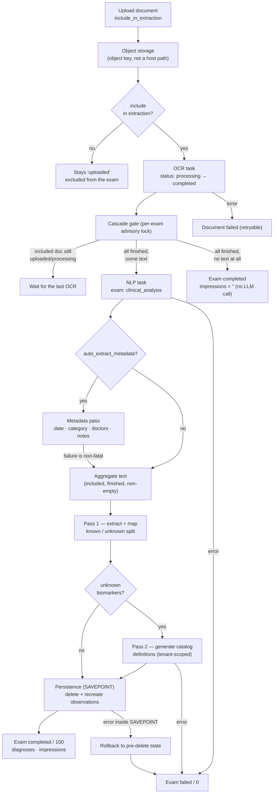
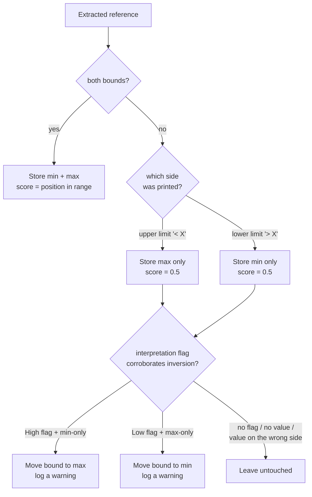
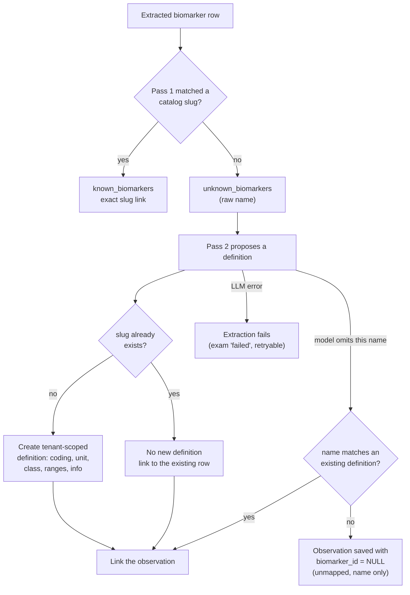
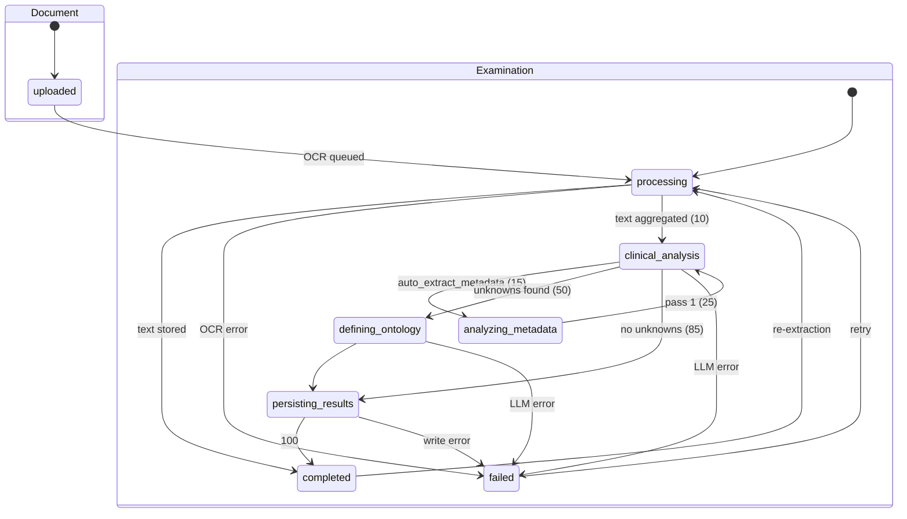

# Document Extraction Pipeline

How a document uploaded into an examination becomes FHIR observations: the OCR
stage, the two-pass NLP extraction, the reference-range and unit rules, what
happens when a biomarker is not in the catalog, and what the system does at every
failure point.

Scope: the **document → examination** path (uploaded PDFs, photos, DICOM). The
integration/wearable path (FHIR observations arriving from a sync provider)
shares the `Observation` write contract but not this pipeline — see
[INTEGRATIONS_FRAMEWORK.md](INTEGRATIONS_FRAMEWORK.md).

- **API:** `POST /api/v1/documents/{id}/extract`,
  `POST /api/v1/examinations/{id}/extract`, `GET /api/v1/examinations/{id}/logs`
- **Operator UI:** `/task-monitor` ([TASK_DEBUGGING_GUIDE.md](TASK_DEBUGGING_GUIDE.md))
- **Code:** `backend/app/workers/ai_tasks.py`, `backend/app/ai/pipeline/`,
  `backend/app/ai/processors/`

## Code map

One row per stage, anchored to the **symbol** that implements it rather than a
line number: a function name survives a refactor, a line number does not. Each
diagram below also carries its entry symbol, so you can go from picture to code
without reading the whole page.

`backend/tests/test_docs_anchors.py` parses this table and fails when a symbol or
module no longer exists — a rename cannot silently leave this page lying.

| Stage | Entry symbol | Module |
|---|---|---|
| Upload and persist | `ingest_document_bytes` | `backend/app/services/documents/document_service.py` |
| OCR | `ocr_document` | `backend/app/workers/ai_tasks.py` |
| Cascade gate | `_check_trigger_cumulative` | `backend/app/workers/ai_tasks.py` |
| NLP task entry | `cumulative_extraction` | `backend/app/workers/ai_tasks.py` |
| Pipeline orchestrator | `MedicalProcessingService.run_extraction_pipeline` | `backend/app/ai/pipeline/service.py` |
| Metadata pass | `MedicalProcessingService.extract_examination_metadata` | `backend/app/ai/pipeline/service.py` |
| Pass 1 extraction | `LangChainStructuredExtractor.parse_document_pass_1` | `backend/app/ai/processors/nlp/langchain_structured.py` |
| Pass 2 biomarkers | `process_unknown_biomarkers` | `backend/app/ai/pipeline/ontology.py` |
| Persist the run | `persist_results` | `backend/app/ai/pipeline/persistence.py` |
| Persist one observation | `save_observation` | `backend/app/ai/pipeline/persistence.py` |
| Numeric status | `_get_observation_status` | `backend/app/services/analytics/status.py` |
| One-sided ranges | `correct_one_sided_range` | `backend/app/services/biomarkers/reference_ranges.py` |
| Progress and streaming | `TaskProgressTracker.update_examination_status` | `backend/app/workers/task_logger.py` |
| Model resolution | `resolve_task` | `backend/app/ai/providers/resolution.py` |
| UI status | `computeStatus` | `frontend/src/utils/biomarkerUtils.ts` |
| UI range text | `getRangeText` | `frontend/src/hooks/useBiomarkers.ts` |

---

## 1. What triggers extraction

Six paths start an OCR or NLP run; the seventh, the OCR → NLP cascade, is
automatic and covered in §3.3.

| Trigger | Where | What it enqueues |
|---|---|---|
| **Upload with "include in extraction" on** | `POST /api/v1/documents` (multipart, `include_in_extraction=true`) | OCR for that document, immediately at upload time |
| **Extract document** | `POST /api/v1/documents/{id}/extract` | OCR for one document (status `processing`, progress 10) |
| **Full reconstruction** | `POST /api/v1/examinations/{id}/extract` `{"mode":"full"}` (default) | OCR for **every** document in the exam with `include_in_extraction=true`; exam `processing` / 5 |
| **Fast extraction** | `POST /api/v1/examinations/{id}/extract` `{"mode":"extract_only"}` | NLP only, over the text already stored; exam `processing` / 10 |
| **Document edited** | `PATCH /api/v1/documents/{id}` | OCR again when inclusion changed and the document is `uploaded`/`failed`; otherwise NLP-only re-run |
| **Retry** | `POST /api/v1/task-monitor/documents/retry/{id}` | OCR again for one document |

Two important properties:

- `include_in_extraction` defaults to **false**, both in the column and in the
  upload form field. A document that is never included is never OCR'd by an
  upload, never aggregated, and never counted as pending — but it can still be
  extracted on demand with "Extract document".
- **"Full reconstruction" never calls the LLM itself.** It queues OCR per
  document, and each finishing OCR task decides whether the exam is ready for NLP
  (§3.3). That is why a "full" run on an examination with ten documents makes ten
  OCR calls and one extraction call.

Queuing is best-effort when the broker is down: the row is committed, the
dispatch failure is logged, and the document sits in `uploaded` until a manual
extract or retry. No in-process fallback is wired — an in-process helper exists
in the worker module but no route calls it, so a broker outage means "extract
again later", not "extract in the API process".

---

## 2. End-to-end flow

*Entry symbols: `ocr_document` → `_check_trigger_cumulative` → `cumulative_extraction` (`backend/app/workers/ai_tasks.py`), then `MedicalProcessingService.run_extraction_pipeline` → `persist_results`.*

---

## 3. Stage reference

### 3.1 Upload and storage

The file is read in capped chunks (50 MB by default, `MAX_UPLOAD_SIZE`) and
written to the configured object store. The database row keeps an **object key**,
never a filesystem path; the OCR worker materializes the key into a `0600` temp
file and deletes it on every exit path. Upload writes an audit event
(`create_document`).

Documents from an integration are de-duplicated on
`(source_integration_id, external_id)`; documents uploaded by a user are not
de-duplicated.

### 3.2 OCR

| Aspect | Behaviour |
|---|---|
| Model | Resolved for the `ocr` task: specialist assignment (user → tenant → system), then the assignment's fallback provider/model pair, then the capability default, then environment settings |
| Provider | `openai`-compatible vision model, or `tesseract` (local, no LLM) |
| File routing | `.pdf` and `.dcm` are converted to page images first (`pdf2image` / `pydicom`, images capped at 2048 px, JPEG q90); every other suffix goes to `extract_text` |
| Output | Markdown, stored in `documents.extracted_text` |
| Progress | `processing` / 10 at start, `completed` / 100 on success |
| Failure | `failed` / 0 with a generic message ("OCR processing failed; see server logs with the task id") for ordinary roles; the real exception goes to the task log, not to the user |

OCR text is *not* interpreted here — a lab row, a header, and a page number all
land in the same blob.

### 3.3 Cascade gate (the only auto-trigger)

After each OCR completion, `_check_trigger_cumulative` decides whether the
examination is ready:

1. It takes a per-examination **Postgres advisory lock**
   (`pg_try_advisory_xact_lock`). If another OCR completion holds it, this one
   returns immediately — otherwise a multi-document upload would fire the NLP
   task several times (double LLM cost, racing catalog creation).
2. It looks for **included** documents still in `uploaded` / `processing`. Any one
   of them means "not yet" — return and let the last completion decide. A document
   outside extraction is invisible to this check, so extracting one manually never
   blocks the examination.
3. When none are pending, it checks for at least one included, finished document
   with non-empty text:
   - **yes** → enqueue the NLP task with the completing document's owner as the
     user context;
   - **no** → the gate writes the examination to `completed` / 100 with
     `impressions = ""`, so a blank scan does not burn an LLM call to invent
     findings. **That write is not committed in the current release** — the
     worker's session closes with the transaction open, so the row keeps its
     previous status and the operator sees nothing (§9).

A document stuck in `processing` therefore blocks the exam until it finishes or
the 20-minute stuck-task cleanup fires (§8).

### 3.4 Aggregation

The NLP task collects documents where `include_in_extraction = true` **and**
`status in (completed, failed)` **and** the stored text is non-empty, and joins
them with a `--- Document ---` separator. `failed` is included on purpose: a
document whose *re-*OCR failed still carries the text of its previous successful
run, and that text is still evidence.

No documents with text → the exam is marked `completed` / 100 with no LLM call.

### 3.5 Metadata pass (optional)

Runs only when the examination has `auto_extract_metadata` set (default false).
It writes a separate, cheaper extraction back onto the examination:

| Field | Rule |
|---|---|
| `examination_date` | `YYYY-MM-DD`; an unparsable date is ignored, so the date set earlier in the run stands |
| `category` | Matched against existing category slugs (tenant + global); a new one is created as a tenant-scoped concept with a grey placeholder colour |
| `clinical_notes` | Appended under an `AI Extracted Notes:` heading, never overwriting existing notes |
| `doctor_names` | Titles (`Dr.`, `Prof.`) and suffixes (`MD`, `PhD`) stripped; matched case-insensitively within the tenant; otherwise a new doctor row is created |

Any failure in this pass is logged as `metadata_extraction` and **swallowed** —
extraction continues.

### 3.6 Pass 1 — extraction and mapping

One structured LLM call over the whole aggregated text. The prompt carries four
things: the text, the biomarker catalog (slug, name, aliases, `value_type`, and —
for state biomarkers — the allowed state codes), the medication catalog
(id, name), and the exam's existing findings as reference context, so a second
document merges into the first instead of replacing it.

The model returns: `known_biomarkers`, `unknown_biomarkers`,
`known_medications`, `unknown_medications`, `diagnoses`, `impressions` (and two
fields nothing consumes today, see §9).

Rules the prompt fixes explicitly:

- numeric values and both range bounds are parsed as floats;
- **one-sided references keep their side**: `< X` / `≤ X` → `max = X, min = null`,
  `> X` / `≥ X` → `min = X, max = null`;
- a **state** biomarker produces no number, only a code from `allowed_states`
  (plus its code system URL);
- medications are reduced to the clean generic name (no strength, no dose form);
- the narrative `impressions` string is the exam-level summary.

A failure here propagates: the task raises, the exam goes `failed` / 0 with the
error message, and nothing is written.

### 3.7 Pass 2 — ontology generation for unknowns

Only runs when Pass 1 reported unknowns. One LLM call per entity kind (biomarkers,
medications), asked to produce standardized catalog definitions.

For each proposed biomarker definition:

1. `proposed_slug` is **sanitized** (`sanitize_slug`) before it touches SQL —
   slugs are interpolated into analytics queries, and this write bypasses the
   Pydantic validator.
2. `raw_name → slug` is recorded in a map, so the observation from Pass 1 can be
   linked even though it was extracted before the definition existed.
3. If the slug already exists (in the tenant's visible catalog), no definition is
   created — the existing row is used.
4. Otherwise a `BiomarkerDefinition` is created with `scope = TENANT` and the
   examination's `tenant_id`, carrying the proposed coding system/code, aliases,
   class concept (category → kebab slug resolved or created as a biomarker class),
   the reference ranges from the document, `is_telemetry`, the preferred unit, and
   a generated Markdown `info` panel.
5. Units: the preferred unit symbol is matched case-insensitively; an unknown
   symbol creates a `Unit` row with a `1.0` multiplier and `OTHER` quantity type
   (so it normalizes to itself).

Ranges in Pass 2 follow the same one-sided convention as Pass 1, and the prompt
forbids a synthesized range that contradicts the extracted value + flag (a `High`
result must sit above the range). When the document prints no range, the model may
supply the standard clinical one — this is the one place a range can be invented,
and it is bounded by that contradiction rule.

Medications: definitions are de-duplicated by case-insensitive name against
system + tenant rows, tenant row winning, and the clean name is added to the
`raw_name → name` map.

A failure in Pass 2 fails the whole task (the exam goes `failed`), rather than
silently persisting observations without a catalog entry.

### 3.8 Persistence

The write runs inside a **SAVEPOINT**: all of the examination's observations and
medications are deleted and recreated. If anything raises mid-write, the savepoint
rolls back and the previous clinical record survives — re-running extraction can
never shrink a record by accident.

Per biomarker row:

- **Link** — known: the definition at `matched_slug`. Unknown: the slug from the
  Pass-2 map, else a name match, else no definition at all (§5).
- **Provenance** — `document_id` is the first aggregated document whose text
  contains the extracted name (case-insensitive substring), else null.
- **Effective time** — the examination's date at 00:00 UTC.

#### Numeric biomarkers

| Field | Rule |
|---|---|
| `value_quantity` | `{value, unit}` as printed |
| `raw_unit_id` | the matched `Unit` row for the printed symbol; an unknown symbol creates one |
| `normalized_value` | `value × raw.multiplier`, then divided by the preferred unit's multiplier when the biomarker has one, else left in base SI |
| `relative_score` | two-sided range: `(value − min) / (max − min)` clamped to `[0, 1]`; one-sided: `0.5`; no range: null |
| `lab_reference_range` | `{min, max}` exactly as extracted (see §4) |
| `interpretation` | normalized flag (`High`/`H` → the canonical interpretation vocabulary) |
| `category` | the class concept's `fhir_observation_category`, else `laboratory` |
| `code` | the linked definition's coding system/code/display, else empty |

Before that, the **one-sided sanitizer** runs: if the interpretation flag and the
value both corroborate that a model put a single bound on the wrong side (`High`
with `min`-only above the value, or `Low` with `max`-only below it), the bound is
moved and a warning is logged. Bounds are corrected, never dropped; ambiguous
cases are left untouched.

Every row passes the **write-time FHIR gate** (`assert_valid_fhir`). A row that
cannot be projected to valid FHIR is skipped with a warning — one bad row does not
abort the document.

#### State biomarkers

A categorical result (positive/negative/indeterminate…) bypasses the numeric path
entirely: no value quantity, no unit, no score, no range. The value is built as a
`valueCodeableConcept` (code system defaulting to the HL7 interpretation system).
Then:

- matched definition is not `state` → **skipped** with a warning;
- FHIR gate fails → skipped;
- code not in the definition's `allowed_states` → **skipped** with a warning
  (nothing is written).

#### Medications

One row per extracted medication (`ACTIVE`, linked to the exam and patient), with
`catalog_id` filled when the (mapped) name matches the catalog. Dosage and reason
are carried through.

### 3.9 Finalize

Diagnoses and impressions are written to the examination, `extraction_status`
becomes `completed` with progress 100 and `error_message` cleared. Documents,
observations, and the task log are the record of what happened.

---

## 4. Reference ranges

Ranges are the most fragile part of lab text, because `< 10` and `> 10` need
different storage, and a single `[min, max]` pair can only express them by leaving
the other side null.

| Printed | Stored as | `relative_score` | Status for an out-of-range value |
|---|---|---|---|
| `3.9 – 5.6` | `min 3.9`, `max 5.6` | position in range, 0–1 | `Low` below, `High` above |
| `< 10` (or `≤ 10`) | `min null`, `max 10` | `0.5` | `High` above 10 |
| `> 5` (or `≥ 5`) | `min 5`, `max null` | `0.5` | `Low` below 5 |
| inverted, `High` flag, value above the lone bound | corrected to `max = bound` | `0.5` | `High` |
| inverted, `Low` flag, value below the lone bound | corrected to `min = bound` | `0.5` | `Low` |
| inverted, no flag or no value | left as stored | `0.5` | falls back to the stored interpretation |
| absent | `null` | `null` | interpretation string, else the built-in standard range for a few common markers |

Why `0.5` for one-sided ranges: the score means "position inside a two-sided
window". A single bound has no window, so the score stays neutral and the **stored
shape** carries the direction. Consumers must therefore check the bounds, not the
score — the status algorithms do exactly that (`app/services/analytics/status.py`
and `frontend/src/utils/biomarkerUtils.ts` both apply the interior-score shortcut
to two-sided ranges only).

Two consequences worth knowing:

- A one-sided range can only be corrected when the lab prints a flag. Two-sided
  data is never modified, and a genuine single bound is never moved.
- **Range values are not unit-converted.** Only the measured value is normalized
  into the biomarker's preferred unit. A document printing the range in a
  different unit than the result keeps the range as printed.

Rows written *before* the one-sided convention existed are not rewritten by
this pipeline; re-extracting the examination is the repair path.

*Entry symbols: `correct_one_sided_range` (storage decision, called from `save_observation`), `_get_observation_status` and `computeStatus` (what the badge shows).*

---

## 5. When the biomarker does not exist

"Does not exist" has several distinct outcomes. Only one of them creates data.

*Entry symbols: `process_unknown_biomarkers` (`backend/app/ai/pipeline/ontology.py`) and the link fallback in `persist_results`.*

| Case | Result |
|---|---|
| Catalog hit | Observation linked to the definition; coding copied from it |
| New biomarker | Definition created `scope=TENANT` for the examination's tenant; observation linked; catalog grows without a manual step |
| New biomarker whose slug already exists | No duplicate definition; observation linked to the existing one |
| Pass 2 returns nothing for a name | Name-match fallback, else the observation is stored **unmapped** (name only) — visible in trends as an unlinked row |
| Pass 2 raises | Whole extraction fails; nothing is persisted |
| Numeric value for a `state` biomarker | Written as a numeric observation without a contract check — a known gap, see §9 |
| State value for a `quantity` biomarker | Row skipped, warning logged |
| State code outside `allowed_states` | Row skipped, warning logged |
| Multi-state (component[]) biomarker | Not produced by this pipeline; it only writes single values |
| Two rows for the same marker in one document | Both persisted — there is no within-document de-duplication |

Auto-created definitions are **tenant-scoped**, and `slug` is unique **per
tenant** (`(slug, COALESCE(tenant_id, sentinel))`), so two tenants may hold the
same slug — each links to its own row. The lookup that checks "does this slug
already exist" has no tenant filter and expects a single row, which becomes
fragile once a tenant row and a system row share a slug (§9).

---

## 6. Case catalogue

### Documents and text

| Situation | Behaviour |
|---|---|
| `include_in_extraction = false` | Never OCR'd by an upload, never aggregated, never counted as pending |
| OCR fails on one document | `failed` / 0; the exam still proceeds if another included document produced text |
| Every included document fails or is blank | The gate writes `completed` / `impressions = ""` and no LLM call runs — but the write is not committed, so the examination keeps its previous status (§9) |
| A document is still `processing` | The cascade gate waits indefinitely: there is **no document-level cleanup**, and the examination cleanup skips a gate that never fires |
| A document outside extraction is extracted manually | It is OCR'd; the pending check ignores it, so it never blocks the examination. If no included document has text, the gate attempts the same uncommitted completion write |
| A document is added after a completed run | Turning inclusion on re-queues OCR (if `uploaded`/`failed`), otherwise re-runs the NLP pass |
| The stored text is edited | NLP-only re-run for the examination |
| Multi-document examination | One aggregated text, one Pass 1 call |
| "Full reconstruction" on an already-extracted examination | Re-OCRs every included document, then re-extracts; the previous observations are passed as reference context, and the write replaces the examination's whole observation set |
| "Fast extraction" | Skips OCR entirely; fails to produce findings if no document has text yet |

### Failures and recovery

| Failure | Where it shows | Recovery |
|---|---|---|
| Broker unreachable at upload | Document stays `uploaded`; warning in logs | "Extract document" or retry from `/task-monitor` |
| No OCR provider and no local fallback usable | Document `failed` | Configure a provider; retry |
| No NLP provider and no API key | The rule-based fallback cannot run Pass 1 → exam `failed` with an explicit error | Assign a model to the `nlp` task, retry |
| Pass 1 / Pass 2 LLM error | Exam `failed` / 0, message on the exam row | Retry; check provider health and quotas |
| Row fails the FHIR gate | Extraction still `completed`; the row is skipped and logged | Fix the source data and re-extract |
| State observation violates the value contract | Extraction still `completed`; the row is skipped and logged | — |
| Database error during persistence | SAVEPOINT rollback, exam `failed`, previous observations intact | Retry |
| Worker killed at the 15-minute task limit | Row keeps its last status | The 20-minute cleanup marks it `failed` |
| Exam retry endpoint | Resets `extraction_status` to null / 0 | It does **not** enqueue anything; re-run extraction from the examination view |

---

## 7. Where the results land

| Destination | Content |
|---|---|
| `observations` | One row per numeric or state result (FHIR-shaped JSONB + relational columns: `biomarker_id`, `raw_value`, `normalized_value`, `relative_score`, `lab_reference_range`, `document_id`) |
| `medications` | One row per extracted medication, linked to the exam and patient |
| `examinations` | `diagnoses`, `impressions`, `extraction_status`, `extraction_progress`, and (when the metadata pass runs) date, category, notes, doctors |
| `biomarker_definitions` + `biomarker_reference_ranges` | Auto-created tenant-scoped entries for previously unknown markers |
| `units` | A new row when a document uses a symbol the catalog does not know |
| `concepts` | A new examination category when the metadata pass proposes one |
| `doctors` | A new row per unrecognised physician name (metadata pass only) |
| `task_logs` | Stage-by-stage `TaskLogger` entries (`ocr_start`, `config_loaded`, `text_aggregated`, `nlp_pass_1_completed`, `metadata_updated`, …) |
| `audit_events` | Document writes (upload, update, delete) |

Observation provenance is coarse: `document_id` is a substring match against the
aggregated text, so the link can point at the wrong document when the same marker
name appears in several. It is never null-but-guessed: no match means null.

---

## 8. Status, progress and observability

Documents and examinations carry **separate** status vocabularies. They are easy
to conflate; the Task Manager renders both.

*Entry symbols: `TaskProgressTracker.update_document_status` / `update_examination_status` (`backend/app/workers/task_logger.py`).*

| Examination status | Progress | Meaning |
|---|---|---|
| `processing` | 5 / 10 | Queued, or OCR running |
| `analyzing_metadata` | 15 | Metadata pass |
| `clinical_analysis` | 10 → 25 | Pass 1 running |
| `defining_ontology` | 50 | Pass 2 running |
| `persisting_results` | 85 | Writing observations |
| `completed` | 100 | Done (also: nothing to analyse) |
| `failed` | 0 | Error message on the row |

Rows written by older versions may still carry `aggregating` or
`analyzing_text`. Both are covered by the stall cleanup, but the current pipeline
sets neither.

Live updates: every status write publishes to Redis, and the WebSocket endpoint
streams `document_progress` / `examination_progress` messages to
`user:{owner}:tasks` and `tenant:{tenant}:tasks` (ordinary users see their own
channel; managers and admins also get the tenant stream with error details).
Clients that miss an event can poll the exam row or the document status endpoint.

Stall thresholds — all three act on **examinations**, never on documents:

| Threshold | What it covers |
|---|---|
| 15-minute Celery hard limit | Kills the worker mid-task; the row keeps its last status |
| 20-minute beat cleanup (every 5 min) | Marks stale exams `failed` for `aggregating`, `analyzing_text`, `clinical_analysis`, `defining_ontology`, `persisting_results` — **not** `processing` |
| 20-minute boot cleanup (process start only) | Same list **plus** `processing` — the only path that clears an exam stuck before the pipeline starts |
| 10-minute "stalled" badge | Visual only, in the Task Manager |

A document stuck in `processing` is never cleaned up by any of them, and it keeps
the examination's cascade gate waiting. See
[TASK_DEBUGGING_GUIDE.md](TASK_DEBUGGING_GUIDE.md) for the triage flow.

---

## 9. Limitations and known gaps

Documented so they are not mistaken for intended behaviour:

1. **A numeric result for a state biomarker is not rejected.** The state branch
   validates membership, but the numeric branch does not check the matched
   definition's `value_type`, so a model that returns a number for a categorical
   marker produces a numeric observation.
2. **Pass 1 asks for two fields nothing persists** — `document_category` and
   `patient_info`. The analytics code reads `documents.entities["document_category"]`,
   but no extraction path writes that JSONB, so the read is always empty. Tokens
   are spent on output that is discarded.
3. **Reference ranges are never unit-converted**, only the value is (§4).
4. **No within-document de-duplication** — repeated rows become repeated
   observations, and re-extraction deletes and recreates every observation of the
   examination.
5. **Pre-convention rows are not repaired.** Only re-extraction fixes an inverted
   one-sided range written by an older version.
6. **Provenance is a substring match** against the aggregated text (§7).
7. **The unknown-biomarker slug lookup expects exactly one row.** It queries by
   slug without a tenant filter and calls `scalar_one_or_none()`. Whenever a
   tenant's auto-created row and a system row share a slug (the catalog grew
   after the tenant created it), the query matches two rows and the extraction
   fails instead of reusing one.
8. **No per-row review gate.** Extraction writes observations directly; the
   proposal/approval flow applies to agent-initiated changes, not to document
   extraction.
9. **The gate's blank-examination write never commits.** When every included
   document is blank or failed, the gate writes `completed` / `impressions = ""`
   on a session that closes with the transaction open, so the write rolls back.
   The examination keeps its previous status (often `processing`, or null for an
   upload-triggered run), and the operator sees a run that appears to hang.
   Because the beat cleanup does not cover `processing`, only a restart clears it.
10. **Nothing cleans up a stuck document.** No task marks a document `failed`
   against the 20-minute threshold; the badge is visual. A document abandoned in
   `processing` blocks the examination's gate permanently.
11. **The gate can fire the NLP task twice.** The per-examination advisory lock
   only deduplicates overlapping checks: two completions can commit, then pass
   the lock one after the other, and both see no pending document. The lock key
   also derives from Python's salted `hash()`, which is stable across a prefork
   pool (children are forked, not re-seeded) but differs between worker replicas
   and between the worker and the in-process fallback path.
12. **Workers read every tenant's biomarker catalog.** Celery tasks run under a
   system tenant context, so the catalog assembled for Pass 1 (and the
   `slug → definition` map used when persisting) can include another tenant's
   auto-created definitions. Those names and aliases then travel to the model
   provider in the prompt, and a cross-tenant slug can win the map.
13. **The whole biomarker catalog goes into every Pass 1 prompt** (slug, name,
    aliases, and every state code). Prompt size and cost grow with the catalog,
    and a large tenant catalog approaches the context limit.
14. **Document text is untrusted input to the extractor.** A crafted document can
    steer the model's output; there is no review step before the observations are
    written.
15. **A missing printed range leaves `relative_score` null**, even when the
    biomarker definition (or a stratified range) knows one. Status still resolves
    through the definition range; the score does not.

---

## See also

- [AI_SYSTEM.md](AI_SYSTEM.md) — provider/model resolution, task registry, call auditing
- [ONTOLOGY_CATALOG.md](ONTOLOGY_CATALOG.md) — catalog schema and write contract
- [STATE_BIOMARKERS.md](STATE_BIOMARKERS.md) — categorical results and their contract
- [TASK_DEBUGGING_GUIDE.md](TASK_DEBUGGING_GUIDE.md) — diagnosing stuck OCR/NLP tasks
- [ARCHITECTURE.md](ARCHITECTURE.md) — where this pipeline sits in the system
